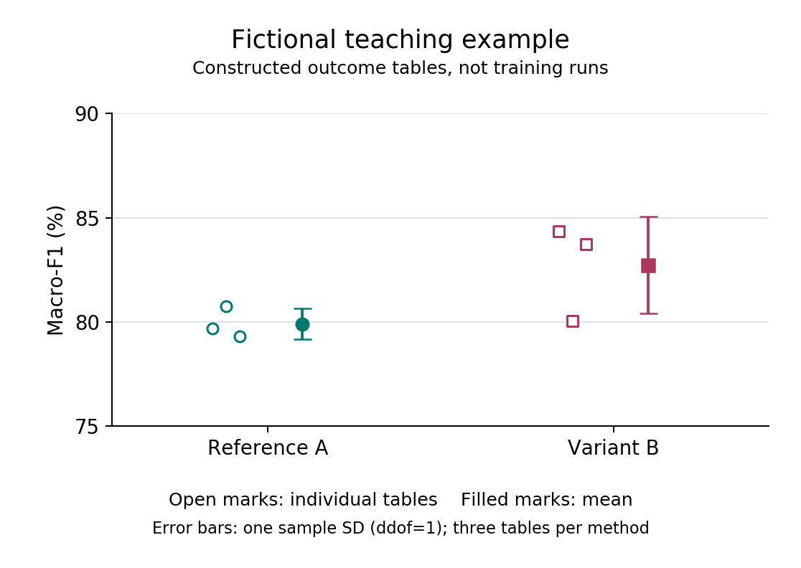

# 同一份结果来源，生成图表并支撑结果文字

[English](README.md) | [实验执行指南](../../../references/experiment-execution_CN.md)

**原创虚构教学数据，没有训练模型，也没有采集测量数据。** 本例演示如何用同一份
混淆矩阵输入生成口径一致的表、图和结果说明，不是任何工业方法有效性的证据。

## 运行

绘图需要 Python 3.7+ 和 Matplotlib。若环境中尚未安装，可在自行管理的环境中使用
`python -m pip install matplotlib`；仅阅读已保存示例无需安装。生成程序不使用
API 密钥、GPU、联网服务，也不执行模型训练。

在仓库根目录运行：

```bash
python assets/examples/result-workflow/build.py --output demo-results
```

输出目录必须尚不存在。程序生成 `table.md`、`summary.csv`、`macro-f1.png` 和
`evidence.json`，不修改输入或论文。记录包含输入及生成程序的哈希、结果表标识、
未舍入统计量、环境版本和产物哈希；这些用于追踪来源，不证明科学有效性。字体及
渲染版本改变可能影响图片字节，而不改变指标数值。

## 怎样阅读



[生成的表格](table.md) 按每种方法的三个构造结果报告均值与样本标准差（ddof=1）。
先分别计算每个结果表的各项指标，再对同一指标求统计量。JSON、CSV 采用 0 到 1
的量纲，展示表格和图片采用百分数，相应标准差以百分点计；它不是相对百分比
变化，也不是置信区间。

**仅针对该虚构例子的结果说明：**

> 在此构造示例中，Variant B 的平均宏平均 F1 高于 Reference A（82.73% 对 79.90%），
> 但不同结果表之间的标准差也更大（2.33 对 0.75 个百分点）。第二组结果则是
> Reference A 较高，两者的宏平均 F1 分别为 80.74% 和 80.06%。

**图注：** 虚构教学示例的宏平均 F1。空心标记表示各方法的三个构造结果，实心
标记及误差线表示其均值与一个样本标准差（ddof=1）。纵轴展示 75%-90% 范围，
以便辨认数值差异。这些结果由示例构造，
并非重复训练所得。

文字既交代汇总差异，也保留其中的例外，不把均值更高写成每次均领先、统计显著
或模型稳定性得到证明。标准差误差线描述的是这些构造数值的分散程度，不能据此
估计未知总体的不确定性。

## 迁移思路，不复制数字

示例约定每张结果表使用相同的 100 个虚构测试样本，其中正常样本 80 个、故障样本
20 个；行为参照类别，列为预测类别。合并一种方法的三个结果表得到 300 次分类
决策，不是 300 个独立采集的测试样本。仅凭混淆矩阵无法核实样本身份相同；逐次
F1 的均值与合并计数后的 F1 也属于不同统计量。

实际研究使用获准的、不可变的结果记录，注明真正的重复单位、样本身份、类别
顺序、划分和指标定义。缺失或失败运行需要明确状态及合理处理，不能静默丢弃或
用零替代。本例专用程序拒绝缺失或重复的结果表、与声明不符的类别支持数以及
已存在的输出路径；它不是通用科研评价程序，也不能替代实验记录。

局部修正时保留作者已认可的图形设计。本例不要求所有论文都采用三次重复、宏
平均 F1、误差条、同一绘图库或同一句式。数值可以复算，但科研主张的选择及范围
仍需作者判断。
